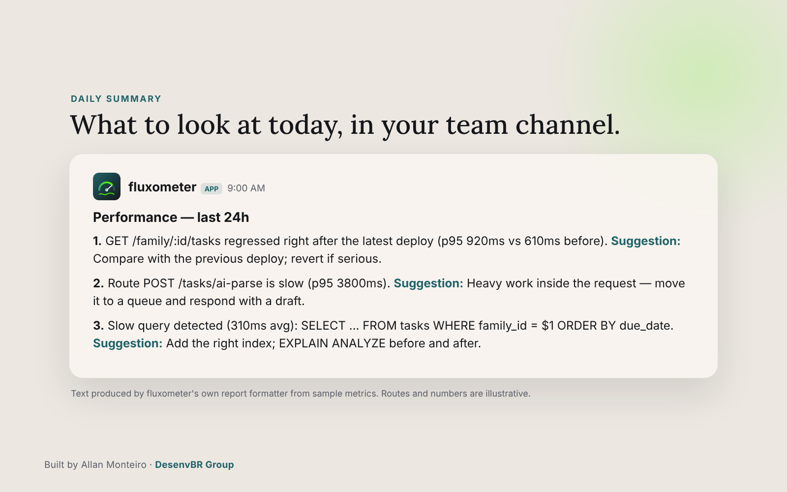
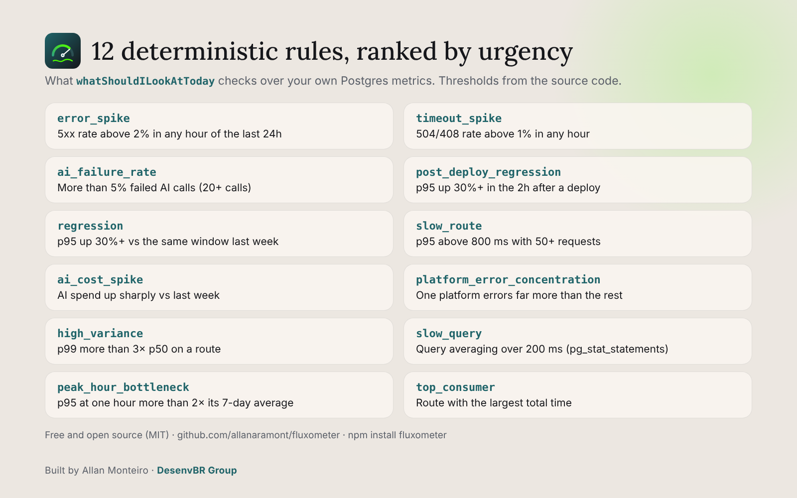

<p align="center">
  
</p>

# fluxometer

Zero-cost performance & bottleneck observability for JS/TS + Postgres apps —
a daily, prioritized Slack summary, plus a local MCP tool so you can just
ask your AI assistant "what should I look at today?"

No dashboard to build or secure. No paid SaaS. No data leaving your own
infra.

Built and maintained by Allan Monteiro at [DesenvBR Group](https://desenvbr.com).



## Install

```
npm install fluxometer
npx fluxometer init
```

1. `npm install fluxometer`
2. `npx fluxometer init` — requires `DATABASE_URL` already set to your
   app's Postgres. If it's missing, you get a clear error, never a raw
   stack trace.
3. The CLI asks for your Slack incoming webhook URL — create one at
   https://api.slack.com/apps → Incoming Webhooks — and for the public
   URL that will receive the daily report (see "Wiring the report
   route" below).
4. It tries to create a read-only Postgres role for you. If it can't
   (common on managed Postgres like Supabase), it prints the SQL to run
   yourself in your provider's dashboard.
5. It generates `FLUXOMETER_CRON_SECRET` and tries to set it (and
   `FLUXOMETER_REPORT_URL`) via `gh secret set` if you have the GitHub
   CLI authenticated; otherwise they're written to `.env` for you to
   set manually.
6. It writes `.github/workflows/fluxometer-report.yml` (plus a
   `fluxometer.vercel-cron.json` Vercel Cron snippet as an alternative —
   merge its `crons` entry into your own `vercel.json` by hand, it is
   never written in place since that file may already hold routes,
   functions or regions config) — just commit it.
7. It merges those entries into your existing `.env` — it never
   overwrites the file, so `DATABASE_URL` and anything else already
   there survive.
8. It checks `.gitignore` and warns if `.env` isn't listed there.
9. Add one line to your app, plus the report route (see below).
10. Deploy.

If a credential ever leaks, run `npx fluxometer rotate` — it replaces
both the read-only role and the cron secret in one go.

The only step outside our control is creating the Slack webhook itself
(that's Slack's own UI) — everything else fits comfortably inside the
~5 minutes promised, for anyone who already has Postgres and Git.

## Usage

### Express

```ts
import { expressMiddleware } from "fluxometer/express";
app.use(expressMiddleware());
```

Failed (4xx/5xx) requests are also recorded with their cause — see
[Failures with a cause](#failures-with-a-cause).

### Fastify

```ts
import { fastifyPlugin } from "fluxometer/fastify";
app.register(fastifyPlugin);
```

### Next.js

```ts
// middleware.ts
export const runtime = "nodejs"; // required — the pg driver doesn't run on Edge
import { fluxometer } from "fluxometer/next";
export default fluxometer();
```

> **Note:** Next.js middleware runs _before_ routing resolves, so this
> adapter can only record which route matched, its status and whether it
> responded — not real request latency (the actual Route Handler runs
> after middleware returns). For latency-sensitive rules (slow routes,
> regressions, latency variance), also call `track.request()` with a real
> duration inside the Route Handlers you care about.

### Wiring the daily report route

`fluxometer/report` exposes the handler the daily cron calls. It takes
any object with a `header(name)` method, so adapt it to your framework:

```ts
// Express
import { handleReportRequest } from "fluxometer/report";
const report = async (req, res) => {
  const result = await handleReportRequest({
    header: (name) => req.header(name),
  });
  res.status(result.status).send(result.body);
};
app.get("/api/fluxometer/report", report); // Vercel Cron always calls with GET
app.post("/api/fluxometer/report", report); // the GitHub Actions workflow uses POST
```

```ts
// Fastify
import { handleReportRequest } from "fluxometer/report";
app.route({
  method: ["GET", "POST"], // GET for Vercel Cron, POST for GitHub Actions
  url: "/api/fluxometer/report",
  handler: async (request, reply) => {
    const result = await handleReportRequest({
      header: (name) => request.headers[name.toLowerCase()] as string | undefined,
    });
    reply.code(result.status).send(result.body);
  },
});
```

```ts
// Next.js — app/api/fluxometer/report/route.ts
export const runtime = "nodejs";
import { handleReportRequest } from "fluxometer/report";
export async function POST(req: Request) {
  const result = await handleReportRequest({
    header: (name) => req.headers.get(name) ?? undefined,
  });
  return new Response(result.body, { status: result.status });
}
export const GET = POST; // Vercel Cron always calls with GET
```

That route is what `FLUXOMETER_REPORT_URL` (set during `init`) should
point to. The generated `fluxometer-report.yml` calls it once a day with
POST and the `x-fluxometer-secret` header; Vercel Cron calls it with GET
and `Authorization: Bearer $CRON_SECRET`. The route accepts either
secret — `FLUXOMETER_CRON_SECRET` or `CRON_SECRET` — so a Vercel app
doesn't need a second one. Without this route wired up, the cron has
nothing to hit and no report is ever sent — `init` can't do this part
for you since it doesn't know your routing setup.

### Settings

| Variable | What it does |
| --- | --- |
| `FLUXOMETER_SLACK_WEBHOOK_URL` | Where the daily report and alerts are posted |
| `FLUXOMETER_CRON_SECRET` or `CRON_SECRET` | The secret the report route accepts (either one) |
| `FLUXOMETER_LOCALE` | `en` (default), `pt` or `es` |
| `FLUXOMETER_APP_NAME` | Shown in the report header, e.g. "fluxometer · Acme" |
| `FLUXOMETER_TIMEZONE` | IANA time zone for "hour of day" findings, e.g. `America/Sao_Paulo` (default UTC) |
| `FLUXOMETER_WATCHDOG` | `off` disables the hourly stale-report check |

### More than one trigger is fine

Vercel Cron on the Hobby plan is best-effort: a run can land anywhere in
the scheduled hour, and occasionally not at all. You can back it up with
a second trigger (a GitHub Actions workflow, or Supabase `pg_cron` +
`pg_net`). The route sends **one report per 6 hours**, however many
triggers call it, and two calls in the same second can't both send.
Send the header `x-fluxometer-force: 1` to run it anyway, for example
when testing by hand.

```sql
-- Supabase: daily at 08:00 UTC, secret kept in Vault
select cron.schedule('fluxometer-report', '0 8 * * *', 'select net.http_post(url := ''https://your-app.example.com/api/fluxometer/report'', headers := jsonb_build_object(''Authorization'', ''Bearer '' || (select decrypted_secret from vault.decrypted_secrets where name = ''your_cron_secret'')), body := ''{}''::jsonb, timeout_milliseconds := 60000)');
```

### When the report doesn't arrive

A report that silently stops is worse than no report, so fluxometer
tells you when it isn't running and why:

- **A run fails** (database down, Slack rejects the post): the route
  answers 500 and posts a short failure notice to the same Slack channel.
- **The report stops arriving** (cron missing, wrong URL, wrong or
  missing secret): the middleware checks at most once an hour, and when
  there has been no successful report in 26h it posts one alert a day
  saying what it found — for example "the secret it sent doesn't match
  FLUXOMETER_CRON_SECRET or CRON_SECRET", "no cron secret is configured
  in the app", or "the report route hasn't been called at all". Without a
  Slack webhook, the same message goes to your logs.
- **Asking your AI assistant**: `whatShouldILookAtToday` lists a
  `report_not_running` item first, with the same diagnosis.
- **Logs**: every rejected call logs the exact reason (no secret sent,
  secret mismatch, or not configured — the route then answers 503).

Attempts are kept in `fluxometer.report_runs` (status and reason only;
secrets are never stored, and URLs in error messages are redacted). Set
`FLUXOMETER_WATCHDOG=off` to disable the hourly check.

After upgrading fluxometer, run the migration again so the new table
exists — `migrate()` from `fluxometer/migrate` is idempotent and safe to
call on every deploy.

### Failures with a cause

`request_metrics` says a request failed; `request_failures` says why and for
whom. With the Express middleware it is on by default: every 4xx/5xx of a
**matched route** is recorded with route pattern, method, status, duration,
and — when your error handler hands it over — the error name and code:

```ts
import { expressMiddleware, setFailureCause } from "fluxometer/express";

app.use(
  expressMiddleware({
    failures: {
      // who it happened to (optional). Read the route params from `info`:
      // Express restores `req.params` when an error leaves a router, so on a
      // failed response `req.params` is usually empty by the time we run.
      tenant: (req, info) => info.params.familyId,
      correlationId: (req) => req.get("x-correlation-id"), // optional
    },
  }),
);

// in your error handler:
app.use((err, req, res, next) => {
  setFailureCause(res, { name: err.name, code: err.code });
  res.status(err.status ?? 500).json({ error: "..." });
});
```

The route label (`/api/families/:familyId/agenda`) is the same whether the
response is sent by the handler or by an error handler further up: Express
restores `req.baseUrl` when an error leaves a router, which used to drop the
mount prefix from failed responses only (`/:familyId/agenda`), splitting one
route into two in `request_metrics`. The label is now rebuilt from the URL
when that happens (plain `/a/:param/b` patterns; regex and wildcard routes keep
what Express reports).

Privacy, because this runs in every app that installs fluxometer:

- The error **message is not stored** unless you set
  `failures: { captureMessage: true }` and pass it in `setFailureCause`.
  When stored, it is scrubbed (emails, tokens, long digit runs, URL query
  strings) and cut to 200 characters — a safety net, not a guarantee.
- Unmatched routes are never recorded (scanner noise; their raw path can
  carry tokens).
- `failures: false` turns it off. Rows follow the same 30-day cleanup.

Outside Express: `track.failure({ route, method, status, errorName, ... })`.

### Audit events

A generic "something changed" record, for any app and any data layer:

```ts
import { track } from "fluxometer";

track.audit({
  entity: "Pet",
  action: "update",
  targetId: pet.id,
  tenant: familyId,
  actor: userId, // an id or a hash — never a name or an e-mail
  source: "http", // or "cron", "internal"...
  route: "/api/pets/:petId",
  correlationId,
  fields: ["name", "weight"], // the NAMES of what changed
  effect: "scoped", // free text, e.g. what it did to your caches
  tags: ["pets-list"],
});
```

Events (and `track.clientMetric` rows) added in the same tick are written as
one multi-row INSERT, because the dedicated pool has only 2 connections. At most
5000 rows wait to be written; beyond that they are dropped and the count is
logged, so a loop of writes can never grow the host's memory.

There is **nowhere to put a value**: `fields` takes names only, and every
field is bounded (50 names, 64 characters each). Hook it where your app
already sees every write (an ORM middleware, a service layer). Rows follow
the 30-day cleanup.

Ask your AI assistant: `recentFailures` (failed requests grouped by route,
status and cause) and `recentAuditEvents` (newest first; filter by `entity`,
`effect` or `tenant`).

A scanner or a retry loop can fail the same route thousands of times a minute,
so failure rows are rate-limited per process: **20 per minute per kind of
failure** (route + status + error name/code), so one noisy kind cannot hide the
others, plus a backstop of 600 per minute in total. Change them with
`FLUXOMETER_FAILURES_PER_KEY_PER_MINUTE` and `FLUXOMETER_FAILURES_PER_MINUTE`.
What was dropped is logged once a minute, with the noisiest kinds, so the
volume stays visible. Treat
`tenant`, `actor` and `targetId` as **opaque ids** (e-mails are redacted, but
never rely on it), and `errorCode` may be a string or a number.

**Upgrading:** run the migration **before** the new code serves traffic —
`migrate()` is idempotent and safe on every deploy. Until the tables exist,
every failed request attempts an insert into a missing table (logged once, but
it uses a pool connection). The read-only role sees new tables automatically
when it was created by `npx fluxometer init`; if you set the role up by hand,
`grant select on all tables in schema fluxometer to fluxometer_readonly;`.

### Any other JS/TS framework

```ts
import { track } from "fluxometer";

track.request({
  route: "/tasks/:id",
  method: "GET",
  status: 200,
  durationMs: 42,
});
track.aiCall({
  model: "gpt-4o",
  durationMs: 820,
  costUsd: 0.004,
  success: true,
});
```

### Ask your AI assistant

```
npx fluxometer mcp
```

Add it to your MCP client (Claude Desktop, Claude Code, Cursor) pointing
`FLUXOMETER_READONLY_URL` at the role `init` created, then just ask:
"what should I look at today?"

## What it checks



12 fixed, deterministic rules — no LLM call, zero extra cost: slow
routes, week-over-week regressions, the biggest time consumer, error
spikes, slow queries, high latency variance, platform-specific error
concentration, timeout spikes, AI cost spikes, AI failure rate,
peak-hour bottlenecks, and post-deploy regressions. Each comes with a
one-line likely cause and suggested fix, in English, Spanish or
Portuguese (`FLUXOMETER_LOCALE`).

The slow-query rule only reports the app's own repeated queries: it
ignores anything that ran fewer than 20 times, migrations, backups
(`COPY`), DDL, catalog introspection from dashboards and ORMs, and the
internal schemas and roles managed platforms like Supabase run their own
services from.

## Agent skill

[`skills/fluxometer/SKILL.md`](./skills/fluxometer/SKILL.md) teaches AI coding
agents (Claude Code, Cursor, Copilot and others) when to call the MCP tool,
how to read each rule and where to look in your code to fix it. Drop the
`skills/fluxometer` folder into your agent's skills directory.

## Security

See [SECURITY.md](./SECURITY.md) for the full credential model.

## License

MIT © Allan Monteiro · [DesenvBR Group](https://desenvbr.com)
